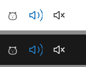
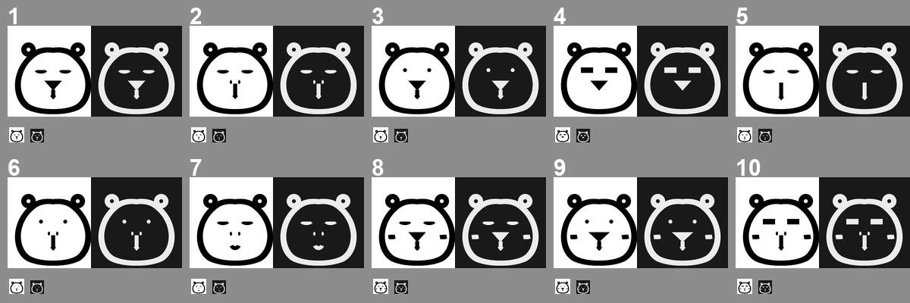
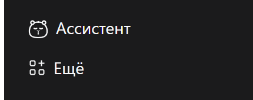

# Голосовой ассистент «Валера» для DSH

Локальный голосовой ассистент-плагин для DeepSeek Harness: обращение по имени,
распознавание речи, озвучка ответов одним голосом на русском и английском.
Всё работает офлайн на CPU, без облака и без отправки звука наружу.

Плагин встраивается в интерфейс DSH: кнопка-капибара рядом с композером,
динамик для переключения «голос/текст», вкладка «Ассистент» в левой колонке.

## Демо

Сигнал и ответ ассистента, записанные тем же движком, что работает в плагине:
[docs/demo/demo.wav](docs/demo/demo.wav) (25 с, 1,1 МБ). Расшифровка и как
записано — [docs/demo/README.md](docs/demo/README.md).

Кнопки рядом с композером — капибара (микрофон) и динамик (голос/текст), светлая
и тёмная тема:

Иконка крупнее:

Пункт «Ассистент» в левой колонке (настоящий скриншот из приложения):

Скриншоты самой панели и строки статуса — [docs/screenshots](docs/screenshots/README.md)
(добавляются отдельно, там же инструкция, что снять).
## Что умеет

- **Активация по кодовому слову.** Своя KWS-модель (40 МБ, 326 КБ веса) слушает
  микрофон постоянно: «Валера», «Валерчик», «Валерий». На проверочной выборке —
  98 % попаданий (45/46) и ноль ложных срабатываний на 150 фразах без имени,
  1 окно на 586 окон фоновой речи.
- **Запись сразу после имени.** Слова до имени отрезаются, первое слово команды
  не теряется. Пауза до конца команды: 1,3 с для короткой фразы, 3,5 с для
  средней, не больше 5 с для длинной диктовки.
- **Распознавание.** Штатный GigaAM через хост-сервис DSH — 64–92 мс на короткую
  фразу. Если провайдер недоступен, работает локальный Whisper small int8
  (sherpa-onnx, CPU).
- **Озвучка.** Silero v5_6_ru, 5 голосов, паузы и ударения; 120–170 мс на фразу.
  Английские слова читает **тот же голос** по произношению из CMU-словаря
  («Hello world» → «хэлоу уорлд», «fox» → «фокс», «hot dog» → «хот дог»).
- **Цифры словами.** «123» → «сто двадцать три», «1.42.4» → «один точка четыре
  два точка четыре», «09:30» → «девять тридцать», «2 500 000» → «два миллиона
  пятьсот тысяч».
- **Непрерывное чтение.** Ответ режется на фразы и планируется в одном
  `AudioContext` встык: длинный ответ читается одной дорожкой, без пауз и
  повторов. Прогресс виден в статусе («Чтение: 12/16»).
- **Прерывание голосом.** Во время ответа микрофон слушает имя: «Валера» или
  «Валера, стоп» гасит озвучку. Текстом в чат — тоже.
- **Окно продолжения.** После ответа микрофон сам слушает 0/3/5 секунд: вопрос
  можно задать без имени, как в разговоре.
- **Личность и память о пользователе.** `~/.dsh/voice-assistant.json`: персона,
  обращение, поправки, факты — подмешиваются в системный промпт новых сессий.
- **Обучение на своём голосе.** Кнопка «Запись голоса» во вкладке «Ассистент»:
  записать примеры с именем и без, затем переобучить KWS-модель.

## Требования

| Что | Значение |
|---|---|
| ОС | Windows 10/11 x64 (проверено), Linux/macOS — код переносим, но скрипты установки только для Windows |
| DSH | ≥ 0.2.2-rc.5, профиль Desktop или Web |
| Python | 3.10+ (берётся встроенный из DSH или из PATH) |
| Диск | ≈ 3 ГБ: Whisper small 357 МБ, Silero TTS 140 МБ, sherpa-onnx ≈ 60 МБ, venv с torch ≈ 1,5 ГБ |
| Железо | обычный CPU (проверено на i5-1135G7 без GPU); GPU не нужен |
| Микрофон | любой, устройство по умолчанию |

## Установка

Подробно, с командами и проверками — [docs/INSTALL.md](docs/INSTALL.md).
Кратко:

1. Скопировать папку плагина в **ASCII-путь** (без кириллицы в пути): например
   `C:\dsh-plugins\voice-dialog`. Кириллица в пути ломает sherpa-onnx и torch.
2. Поставить голосовой рантайм: `pwsh -File engine/tts/setup.ps1`
   (создаёт `.venv`, ставит torch 2.2.2+cpu, скачивает Silero v5_6_ru).
3. Скачать модели распознавания и детектора имени по
   [docs/INSTALL.md](docs/INSTALL.md#модели).
4. Подключить плагин к профилю DSH:
   `mklink /J "%USERPROFILE%\.dsh\profiles\desktop\node_modules\@local\voice-dialog" "C:\dsh-plugins\voice-dialog"`.
5. Перезапустить DSH, включить плагин в настройках, нажать капибару — микрофон
   включён. Сказать «Валера» и команду.

Проверка окружения: `node scripts/doctor.mjs` — печатает, что найдено, чего нет
и как это исправить.

## Настройки

Всё в вкладке «Ассистент»:

- **Способ ответа** — голос или текст (динамик рядом с микрофоном делает то же).
- **Кодовые слова** — список через запятую.
- **Длина записи** — «Целиком» (длинная диктовка) или «По паузам».
- **Чувствительность** — тихий/обычный/шумно.
- **Голос, скорость, паузы** — Silero.
- **Слушать после ответа** — 0/3/5 секунд.
- **Прерывание голосом** — вкл/выкл.
- **Что помнить о пользователе** — факты, персона, поправки (файл
  `~/.dsh/voice-assistant.json`).
- **Запись голоса** — сохранить положительный или отрицательный пример для KWS.

Микрофон по умолчанию **выключен** и запоминается между запусками.

## Как это устроено

Архитектура, замеры и решения по железу — [docs/ARCHITECTURE.md](docs/ARCHITECTURE.md).
Коротко: клиентский плагин слушает микрофон и проигрывает звук, хост-часть
держит локальные движки за loopback-HTTP, речь никуда не уходит.

## Приватность

Звук и текст обрабатываются на этой машине. Хост-маршруты доступны только с
`127.0.0.1`. Телеметрии нет. Сеть нужна один раз — скачать модели.
Подробнее: [docs/PRIVACY.md](docs/PRIVACY.md).

## Ограничения

- Кодовая фраза «Валера» обучена на русскую речь; для другого имени нужна
  своя модель (проект KWS в репозитории разработки).
- Распознавание рассчитано на русский и английский; другие языки не проверялись.
- В режиме «Целиком» запись ограничена 20 минутами (32 МБ тело запроса).
- На машине без Visual C++ Runtime x64 сборка torch может не загрузиться;
  `setup.ps1` копирует нужные DLL рядом с `c10.dll`, если они есть в поставке.

## English summary

A fully local voice assistant plugin for DeepSeek Harness: wake-word activation
with a custom KWS model, GigaAM/Whisper speech recognition, Silero TTS with a
single voice for Russian and English (English words are transliterated by
pronunciation from CMUdict), numbers read as words, and gapless long-form
playback. Everything runs offline on CPU; the plugin talks to its engines over
loopback HTTP only.

## Лицензия

MIT, см. [LICENSE](LICENSE). Модели скачиваются отдельно и живут под своими
лицензиями (Silero TTS — CC BY-NC-SA, sherpa-onnx — Apache-2.0 и т. д.).
